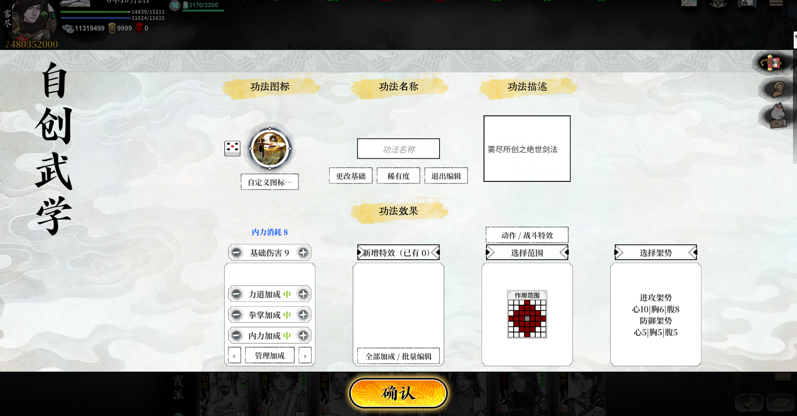
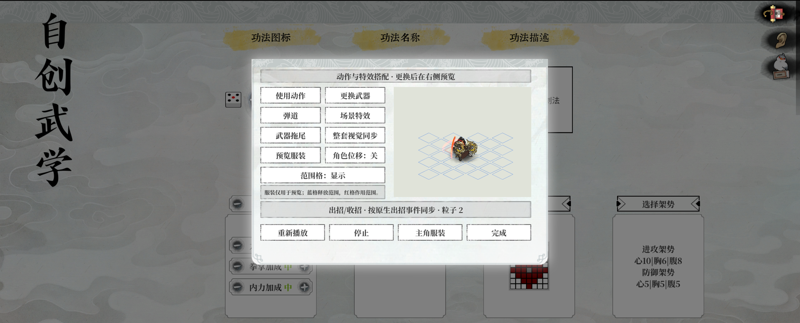

# 0.4.31.27 发布与安装验证

日期：2026-11-14。适配游戏 1.1.3f0 / Windows x64。

## 更新
- 原生自创武学编辑器：基础选择、稀有度、图标、完整加成目录与批量编辑、范围/架势、动作及特效来源搜索筛选。
- 保留旧自创功法编辑器；增加藏经阁原生入口，修复 Shift 详情的缺失创作者记录兼容。
- 展示台保留原生特效生命周期，按 Spine skillshoot 事件时刻播放出招特效。无事件时显示估算；不进行实战伤害结算。
- EXE 内置已校验的 BepInEx 785，支持缺失/损坏文件修复，保留配置，输出安装日志。

## 已验证
- Release 编译：0 警告、0 错误。
- 安装器回归：25 项通过，覆盖完整性、损坏修复、配置保留、路径校验。
- 独立测试目录清空插件、加载器、缓存后，直接运行新版 EXE 安装；首次接口生成完成、插件加载。
- 正式 Steam 目录同样清空安装，使用 Steam 启动；日志确认 H 面板打开、原生编辑入口打开。
- 旧存档首次因测试移走自创定义而异常；恢复原定义及图标后，9 条自创定义注册成功，用户确认恢复正常。安装器未删除用户配置。

## 限制
- 未穷举每种加成组合、全部战斗与存档保存读回。
- 预览不保证与多目标/连击的实战视觉密度相同。
- 构造函数补丁仍有 IL2CPP 后端回退警告，当前可启动。
- 安装阶段离线；首次启动生成接口可能下载 Unity 库。

## 更新方式
退出游戏，把新版 EXE 放在游戏 EXE 同级运行。不要删除旧 config；保留自创定义与图标。安装失败附 LongYinTrainer-install.log；游戏内无响应附 BepInEx/LogOutput.log。无需安装开发用 .NET SDK。

## 功能截图

原生自创武学编辑器：

动作与特效搭配预览：

## 自动回归
10 组模拟回归均通过：书籍目录、类别、城市、战斗、日期、奇遇、资源锁定、图标、功法、技能绑定。模拟回归不替代实机全功能验证。
